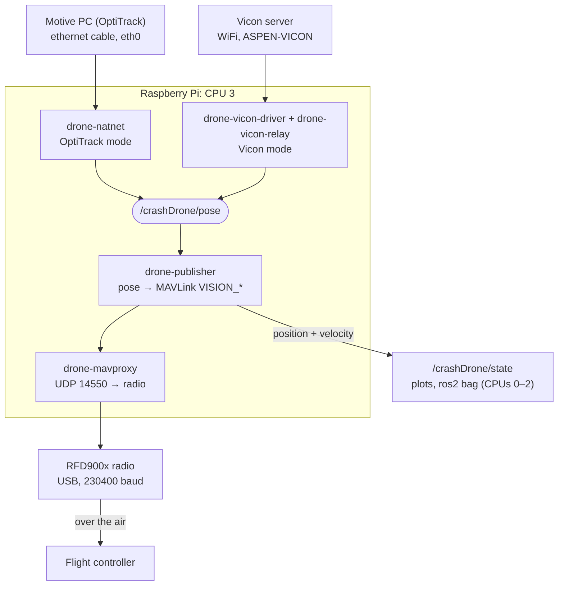

# Strain Drone: Core 3 Pipeline (Raspberry Pi)

Streams motion-capture pose (OptiTrack or Vicon) from a Raspberry Pi to the drone's flight controller over an RFD900x radio.

The whole pipeline runs alone on **CPU 3**. Everything else on the Pi (desktop, WiFi, SSH, network interrupts, plotting) runs on **CPUs 0–2**, so nothing can interrupt the pipeline.



Only one mocap mode runs at a time. Both modes publish to the same topic, `/crashDrone/pose`.

---

## Contents

- [Flying](#flying)
- [`drone` commands](#drone-commands)
- [Setting up a new Pi](#setting-up-a-new-pi)
- [How it works](#how-it-works)
- [Settings](#settings)
- [Troubleshooting](#troubleshooting)
- [Repository layout](#repository-layout)

---

## Flying

Connect to the Pi (over Tailscale):

```bash
ssh straindronenew@100.97.120.117
```

1. Plug in the radio, and either the mocap ethernet cable (OptiTrack) or join the Vicon WiFi (Vicon).
2. Start the pipeline:
   ```bash
   drone start          # OptiTrack
   drone start vicon    # Vicon
   ```
3. Run `drone check`. Every line should say **OK**, and `/crashDrone/pose` should show a rate in Hz.
4. Fly.
5. When done, run `drone stop`.

> In Motive, the rigid body must be named **`crashDrone`**.

### Watching the drone state

Open another SSH terminal. These commands run on CPUs 0–2, so they don't disturb the pipeline. No setup is needed: every new terminal loads `~/drone_env.sh` (from `~/.bashrc`), which sources ROS and sets the same ROS settings the pipeline uses.

```bash
run_commander                                          # send commands to the drone
ros2 topic echo /crashDrone/state                      # live position + velocity
ros2 bag record /crashDrone/state /crashDrone/pose     # record a flight
```

`run_commander` loads the workspace and then runs `ros2 run position_publisher drone_commander`.

---

## `drone` commands

| Command | What it does |
|---|---|
| `drone start` | Start OptiTrack mode |
| `drone start vicon` | Start Vicon mode (stops OptiTrack first if it is running) |
| `drone stop` | Stop whichever mode is running |
| `drone restart` | Restart the running mode |
| `drone restart <service>` | Restart one service: `natnet`, `vicon-driver`, `vicon-relay`, `mavproxy` or `publisher` |
| `drone check` | Health check of CPU isolation, network and message rates on each topic. Each line says OK, WARN or FAIL |
| `drone status` | Which mode is running, and which CPU each thread is on |
| `drone logs` | Follow the live logs of every running service |
| `drone logs natnet` | OptiTrack connection: Motive found, frame rate, rigid bodies detected |
| `drone logs publisher` | Mocap rate and flight-controller send rate every 10 s, time sync, commands |
| `drone logs mavproxy` | Radio and flight-controller link, mode changes, arming |
| `drone radio [seconds]` | Rate sent to the radio and whether the radio keeps up (10 s sample by default) |
| `drone enable` / `drone enable vicon` | Start that mode automatically at boot |
| `drone disable` | Start nothing at boot |
| `drone env` | Prints the ROS settings a terminal needs. Use as `eval "$(drone env)"` |

---

## Setting up a new Pi

Everything needed is in `new_pi_setup/` (or the zipped `new_pi_setup.tar.gz`, which keeps Linux file permissions).

### 1. Before running setup

1. Flash the SD card with **Ubuntu Desktop 24.04 LTS (64-bit)**.
2. On first boot, create a user and connect to a WiFi network with internet.
3. Enable SSH on the Pi:
   ```bash
   sudo apt update && sudo apt install -y openssh-server
   ```
4. Check the settings in `new_pi_setup/drone_pipeline/pipeline.conf`:

   | Setting | Current value | Change it when |
   |---|---|---|
   | `MOTIVE_IP` | `192.168.50.1` | The Motive PC's ethernet uses a different address |
   | `PI_MOCAP_IP` | `192.168.50.2` | You want the Pi on another ethernet address. Keep it in the same `192.168.50.x` range as `MOTIVE_IP` |
   | `VICON_HOST` | `192.168.20.100:801` | The Vicon server has a different address |
   | `VICON_BODY` | `QuadPlane.QuadPlane` | The drone has a different name in Vicon |
   | `RADIO_DEV` | `/dev/ttyUSB0` | The radio shows up on a different port |
   | `MAVPROXY_EXTRA_OUTS` | `""` (empty) | You want extra outputs, e.g. a ground station: `"udp:100.98.109.70:14550"` |
   | `FC_RATE_HZ` | `100` | You want a different send rate to the flight controller |

   You don't need to change the username or folder settings; `setup.sh` fills those in.

5. Set up the Motive PC (OptiTrack only):
   1. Open **Settings → Network & internet → Ethernet** and pick the adapter the Pi's cable is plugged into.
   2. Next to **IP assignment**, click **Edit** and change it to **Manual**.
   3. Turn on **IPv4** and enter:
      - IP address: `192.168.50.1`
      - Subnet mask: `255.255.255.0`
      - Gateway and DNS: leave empty
   4. Click **Save**.
   5. In Motive, set **Streaming → Local Interface** to `192.168.50.1`. Keep the transmission type as **Unicast**.
   6. Allow Motive through Windows Firewall (tick **Public**).

   > **Note:** Motive streams from only one local interface at a time. Once it is switched to `192.168.50.1`, anything that was receiving the Motive stream over WiFi stops getting it.

### 2. Run setup

1. Copy `new_pi_setup.tar.gz` to the new Pi and unpack it:
   ```bash
   scp new_pi_setup.tar.gz <user>@<pi-ip>:~/
   # then on the Pi:
   cd ~ && tar xzf new_pi_setup.tar.gz
   ```
2. From inside the `new_pi_setup` folder, run as yourself (**not** with `sudo`):
   ```bash
   cd ~/new_pi_setup
   bash setup.sh                 # add --enable-boot to start OptiTrack mode at every boot
   ```
   Wait until it prints **Setup finished**. It takes a while and may ask for your password more than once. If it stops with an error, fix the cause and run it again.
3. Reboot:
   ```bash
   sudo reboot
   ```
4. If you need the Vicon WiFi:
   ```bash
   sudo bash ~/add_wifi.sh "ASPEN-VICON"
   ```
5. Plug in the radio and the ethernet cable, then:
   ```bash
   drone start
   drone check     # every line should say OK
   ```

### What `setup.sh` does

- Checks for Ubuntu 24.04, 64-bit, 4+ cores and an internet connection.
- Removes Windows line endings from the scripts, in case the folder passed through Windows.
- Copies the source folders to `~/Documents/drone_position_hold/ros2_ws` and `~/Documents/drone_position_hold_Vicon/ros2_ws`, and puts `drone_env.sh` and `add_wifi.sh` in your home folder.
- Adds the ROS 2 package source and installs ROS 2 Jazzy, MAVROS, Python tools, SciPy and Boost.
- Installs pymavlink for the system Python, and MAVProxy in `~/mavlink_env`.
- Builds the OptiTrack workspace, then the Vicon workspace. A Vicon build failure is only a warning; OptiTrack still works.
- Registers the ROS and workspace libraries in `/etc/ld.so.conf.d`.
- Fills in your username and folders in `pipeline.conf`, then runs `drone_pipeline/install.sh`.

### What `install.sh` does

<details>
<summary>Files, services and permissions</summary>

| Command | What it does |
|---|---|
| `install -d -m 755 /etc/drone-pipeline` | Creates the settings folder |
| `install -m 644 pipeline.conf /etc/drone-pipeline/pipeline.conf` | Copies the settings file. If one already exists, keeps it and only adds missing settings |
| `sed -i 's/\r$//' <file>` | Removes Windows line endings (which break bash scripts) from every copied file |
| `id $DRONE_USER`, then checks for `/opt/ros/jazzy` and the built `position_publisher` | Stops with an error if the user, ROS or the build is missing. A missing Vicon build is only a warning |
| `command -v mavproxy.py` (as the drone user) | Finds MAVProxy, falling back to `~/mavlink_env/bin/mavproxy.py`, and saves the path as `MAVPROXY_BIN` |
| `install -d -o $DRONE_USER $FLIGHT_LOG_DIR` | Creates the flight log folder |
| `usermod -aG dialout $DRONE_USER` | Adds the user to the `dialout` group, which may use the radio's USB serial port |
| `install -m 644 lib/ros-env.sh lib/vicon-relay.py /usr/local/lib/drone-pipeline/` | Copies the helper files |
| `install -m 755 lib/run-*.sh lib/cpu-setup.sh /usr/local/lib/drone-pipeline/` | Copies the start-up scripts and makes them executable |
| `install -m 755 bin/drone /usr/local/bin/drone` | Installs the `drone` command so it works from any folder |
| `sed -e 's/@DRONE_USER@/.../' ... systemd/<unit> > /etc/systemd/system/<unit>` | Copies each service file, filling in the username, CPU core and priorities from the settings |

</details>

<details>
<summary>CPU isolation</summary>

| Command | What it does |
|---|---|
| `systemctl set-property system.slice AllowedCPUs=0-2` | Background system services may only use CPUs 0–2 |
| `systemctl set-property user.slice AllowedCPUs=0-2` | Logged-in users' programs (terminals, desktop) may only use CPUs 0–2 |
| `systemctl set-property init.scope AllowedCPUs=0-2` | The init process may only use CPUs 0–2 |
| `systemctl disable --now irqbalance.service` | Turns off irqbalance, which would undo the interrupt pinning |
| `cp /boot/firmware/cmdline.txt /boot/firmware/cmdline.txt.bak-<date>` | Backs up the kernel boot options |
| Adds `isolcpus=domain,managed_irq,3` to `cmdline.txt` | The kernel never schedules other work on CPU 3 |
| Adds `rcu_nocbs=3` | Moves RCU callbacks (kernel housekeeping) off CPU 3 |
| Adds `irqaffinity=0-2` | Hardware interrupts go to CPUs 0–2 by default |

</details>

<details>
<summary>Mocap ethernet</summary>

| Command | What it does |
|---|---|
| `nmcli connection modify <profile> connection.autoconnect no` | Stops other wired profiles (e.g. DHCP) from grabbing `eth0` |
| `nmcli connection delete mocap-eth` | Removes an old `mocap-eth` profile, if any |
| Writes `/etc/NetworkManager/system-connections/mocap-eth.nmconnection`, then `chmod 600` | New profile: fixed IP `192.168.50.2/24`, no default route (internet stays on WiFi), IPv6 off |
| `nmcli connection reload` | Makes NetworkManager read the new profile |
| `nmcli connection up mocap-eth` | Turns it on now (or when the cable is plugged in) |
| `install -m 755 lib/90-drone-mocap-irq /etc/NetworkManager/dispatcher.d/` | Reruns `cpu-setup.sh` each time the cable connects, because the interrupt settings reset then |

</details>

<details>
<summary>Services</summary>

| Command | What it does |
|---|---|
| `systemctl daemon-reload` | Makes systemd read the new service files |
| `systemctl enable --now drone-cpu-setup.service` | Runs `cpu-setup.sh` now and at every boot: CPU clock at full speed, all interrupts (including `eth0`) on CPUs 0–2 |
| `systemctl restart drone-cpu-setup.service` | Runs it again so new settings apply right away |
| `systemctl enable drone-pipeline.target` | Only with `--enable-boot`: starts OptiTrack mode at every boot |

</details>

At the end it prints whether you need to reboot.

To remove everything:

```bash
sudo bash uninstall.sh && sudo reboot
```

---

## How it works

Mocap driver → `/crashDrone/pose` → `position_publisher` → MAVLink over UDP → MAVProxy → radio → flight controller

If any stage crashes, systemd restarts it after 2 seconds.

### 1. Get the position from the mocap system

**OptiTrack mode** (`drone-natnet`)

- The Motive PC streams the drone's position over a direct ethernet cable to the Pi's `eth0` port.
- `eth0` has a fixed address (`192.168.50.2`); the Motive PC is `192.168.50.1`. This link never carries internet. Internet stays on WiFi.
- The `natnet_ros2` node receives the stream and publishes the drone's pose on `/crashDrone/pose`.
- If the cable is unplugged, the service waits and retries until `eth0` has its IP address.

**Vicon mode** (`drone-vicon-driver` and `drone-vicon-relay`)

- The Vicon server (`192.168.20.100:801`) is reached over WiFi.
- The Vicon driver publishes every tracked object on `/rigid_bodies`.
- `vicon-relay.py` picks out the drone and republishes it on `/crashDrone/pose` (the same topic as OptiTrack).
- If the Vicon server can't be reached, the relay waits, and turns the driver back on when the server returns.

### 2. Turn the position into flight-controller messages (`drone-publisher`)

- `position_publisher` reads `/crashDrone/pose` and converts it into MAVLink `VISION_POSITION_ESTIMATE` and `VISION_SPEED_ESTIMATE` messages.
- It sends them to MAVProxy over a local UDP port (`127.0.0.1:14550`).
- It also publishes `/crashDrone/state` (position, and velocity in the world frame) for plotting and logging.
- Positions are passed on **without rotation**, so the mocap world frame must already be set up as **North-East-Down (NED)**.

### 3. Send it over the radio (`drone-mavproxy`)

- MAVProxy connects local port 14550 to the radio at `/dev/ttyUSB0` (230400 baud).
- The radio on the drone hands the messages to the flight controller.
- If the radio isn't plugged in, MAVProxy waits until it appears.

### CPU isolation

- The kernel keeps CPU 3 to itself (`isolcpus`), and all normal programs are confined to CPUs 0–2. The pipeline runs in `drone.slice`, which only uses CPU 3.
- Each pipeline service runs with real-time scheduling, at the priority set in `pipeline.conf` (higher runs first):

  | Service | Policy | Priority |
  |---|---|---|
  | `drone-natnet` | Round robin (`SCHED_RR`) | 70 |
  | `drone-vicon-driver` | FIFO (`SCHED_FIFO`) | 70 |
  | `drone-vicon-relay` | FIFO | 65 |
  | `drone-mavproxy` | FIFO | 60 |
  | `drone-publisher` | FIFO | 50; its send thread raises itself to 80 |
- `cpu-setup.sh` sends all hardware interrupts, including the mocap ethernet's, and network packet processing to CPUs 0–2, so they never interrupt the pipeline on CPU 3. It also locks the CPU clock at full speed.

---

## Settings

All settings live in `/etc/drone-pipeline/pipeline.conf` on the Pi.

- Most settings only need `drone restart` after editing.
- CPU and priority settings need `sudo bash install.sh` again (from `new_pi_setup/drone_pipeline/`), then a reboot.

---

## Troubleshooting

| Symptom | Likely cause | Fix |
|---|---|---|
| `/crashDrone/pose: no messages` (OptiTrack) | Cable unplugged, Motive not streaming, or Windows Firewall blocking | Check the cable. In Motive check **Streaming → Local Interface** = `192.168.50.1`. Allow Motive through the firewall |
| `eth0 does not have 192.168.50.2` | Ethernet link is down | Plug in the cable, or run `nmcli con up mocap-eth` |
| `Vicon server ... not reachable` | Pi isn't on the Vicon WiFi | Connect to ASPEN-VICON |
| Log says `Vicon body ... not streamed` | `VICON_BODY` doesn't match the object name in Vicon | Copy the name from the log into `VICON_BODY`, then `drone restart` |
| Log says `Vicon body occluded` | Cameras can't see the drone | Check markers and camera coverage |
| MAVProxy log says `Waiting for radio` | Radio not plugged in, or on a different port | Plug it in; check `RADIO_DEV` |
| `ros2 topic` in a terminal shows nothing | Terminal didn't load `~/drone_env.sh` (e.g. a script, or a shell that skips `~/.bashrc`) | Run `eval "$(drone env)"` in that terminal |
| `kernel isolated CPUs` FAIL | Pi hasn't rebooted since install | `sudo reboot` |

To watch input and output rates live:

```bash
journalctl -u drone-publisher -f | grep Stats
```

---

## Repository layout

| Path | What it is |
|---|---|
| `new_pi_setup/` | Turns a new Pi into a drone Pi (see [Setting up a new Pi](#setting-up-a-new-pi)) |
| `new_pi_setup/drone_pipeline/` | Installs and manages the pipeline services |
| `new_pi_setup/drone_pipeline/bin/drone` | The `drone` command |
| `new_pi_setup/drone_pipeline/pipeline.conf` | All the settings |
| `new_pi_setup/workspaces/drone_position_hold/` | ROS 2 code: `natnet_ros2` (OptiTrack → `/crashDrone/pose`), `position_publisher` (pose → MAVLink), visualizer (live plotter) |
| `new_pi_setup/workspaces/drone_position_hold_Vicon/` | ROS 2 Vicon driver |
| `new_pi_setup.tar.gz` | Zipped copy of `new_pi_setup/` (keeps Linux file permissions) |
| `strain-drone-backup/` | Files from the old Pi, in case the pipeline doesn't work |
| `straindronenew-backup-2026-10-29/` | Backup of the `straindronenew` Pi |
